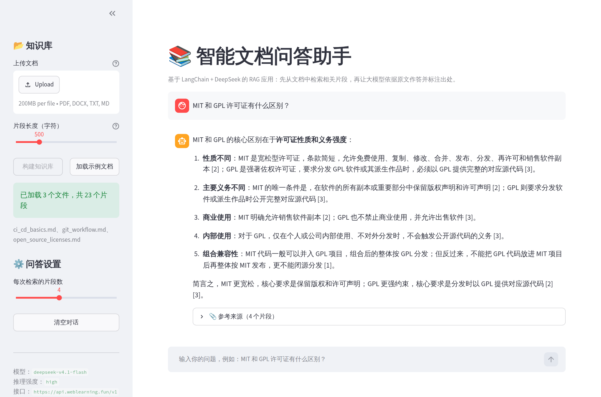
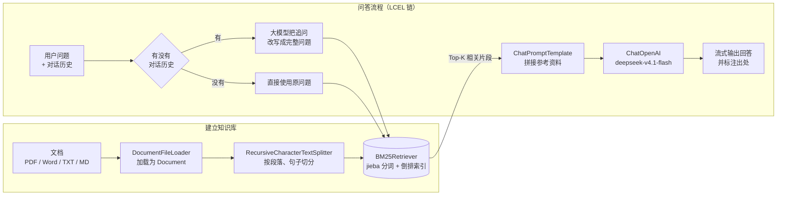
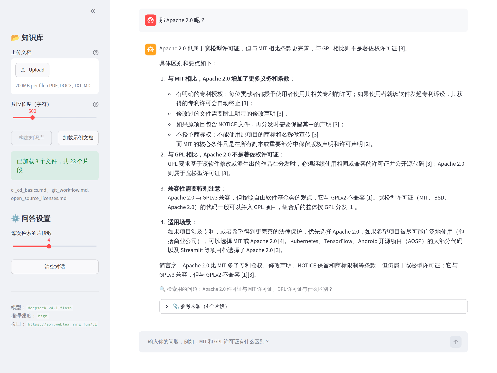
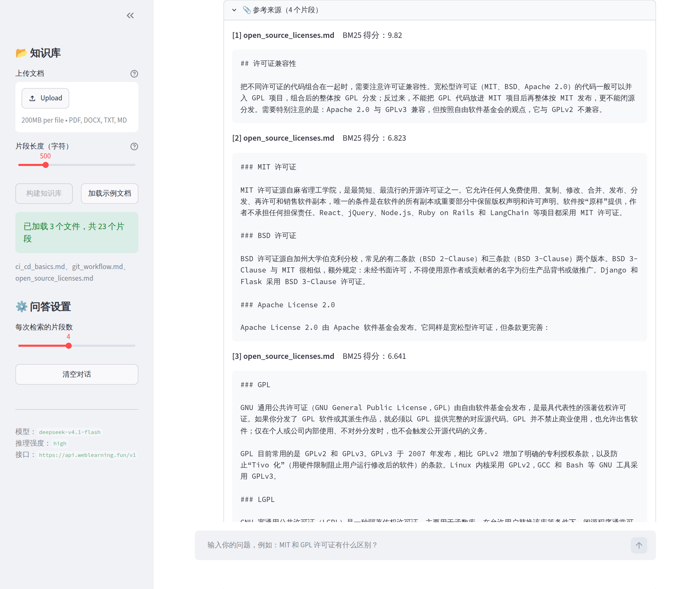

# 📚 智能文档问答助手（LangChain + DeepSeek RAG）

[](https://github.com/3219378872/langchain-docqa-assistant/actions/workflows/ci.yml)


> 《开源软件构建技术》课程期末大作业：基于 **LangChain** 框架和在线大模型 **DeepSeek-V4.1-Flash** 开发的智能文档问答应用。
>
> 开源仓库：<https://github.com/3219378872/langchain-docqa-assistant>

上传 PDF、Word、TXT 或 Markdown 文档后，就可以用自然语言对文档内容提问。系统先从文档中检索出最相关的片段，再交给大模型依据原文作答，并在回答中用 `[1]`、`[2]` 标注出处。这种做法叫作 **RAG（Retrieval-Augmented Generation，检索增强生成）**：大模型能回答它从没见过的私有文档，回答也有据可查，不容易“一本正经地胡说八道”。



## ✨ 功能特性

- **多格式文档**：支持 PDF（记录页码）、Word（.docx）、TXT 和 Markdown，自动识别 UTF-8 / GBK 编码
- **中文检索**：自己实现的 jieba 分词 + BM25 检索器，不需要 Embedding 接口，离线就能建立索引
- **回答带出处**：回答中用 [1]、[2] 标注引用；展开「参考来源」可以看到原文片段、页码和 BM25 得分
- **多轮对话**：追问时先结合对话历史把问题改写完整（例如「它有什么使用禁忌？」→「Git 的 rebase 操作有哪些使用禁忌？」），再去检索
- **不编造**：文档里没有的内容，会直接回答「文档中没有找到相关信息」
- **流式输出**：回答逐字显示
- **两种界面**：Streamlit 网页版和命令行版
- **模型可替换**：任何 OpenAI 兼容接口（DeepSeek、通义千问、Ollama 本地模型等）改 `.env` 即可切换

## 🏗️ 系统架构



| 组件 | 使用的技术 | 作用 |
| --- | --- | --- |
| 应用框架 | LangChain（`langchain-core` 1.x） | Document、Retriever、Prompt、LCEL 链等核心抽象 |
| 大模型 | DeepSeek-V4.1-Flash，推理强度 high | 改写追问、依据资料生成回答 |
| 模型接入 | `langchain-openai`（`ChatOpenAI`） | 对接任意 OpenAI 兼容接口 |
| 文本切分 | `langchain-text-splitters` | 适配中文标点的递归切分 |
| 检索 | BM25 + jieba（自行实现） | 中文关键词检索 |
| 文档解析 | pypdf、docx2txt | 解析 PDF 和 Word |
| 网页界面 | Streamlit | 上传文档、聊天式问答 |
| 工程化 | pytest、ruff、GitHub Actions | 单元测试、代码检查、持续集成 |

## 🚀 快速开始

### 1. 环境要求

- Python 3.11 及以上（Streamlit 1.66 要求 3.11+）
- 一个 OpenAI 兼容接口的 API Key（默认使用 `https://api.weblearning.fun/v1` 上的 `deepseek-v4.1-flash`）

### 2. 安装依赖

```bash
git clone https://github.com/3219378872/langchain-docqa-assistant.git
cd langchain-docqa-assistant

python -m venv .venv
source .venv/bin/activate        # Windows：.venv\Scripts\activate
pip install -r requirements.txt
```

### 3. 配置 API Key

```bash
cp .env.example .env             # Windows：copy .env.example .env
```

编辑 `.env`，把 `LLM_API_KEY` 改成你自己的 Key：

```ini
LLM_API_KEY=sk-xxxxxxxx
LLM_BASE_URL=https://api.weblearning.fun/v1
LLM_MODEL=deepseek-v4.1-flash
LLM_REASONING_EFFORT=high
```

| 变量 | 说明 | 默认值 |
| --- | --- | --- |
| `LLM_API_KEY` | API Key（必填） | 无 |
| `LLM_BASE_URL` | OpenAI 兼容接口地址 | `https://api.weblearning.fun/v1` |
| `LLM_MODEL` | 模型名称 | `deepseek-v4.1-flash` |
| `LLM_REASONING_EFFORT` | 推理强度：`low` / `medium` / `high`；留空表示不发送这个参数 | `high` |

> `.env` 已经写进 `.gitignore`，不会被提交到仓库。密钥一旦推送到公开仓库，即使之后删除也能从提交历史里找回来，所以千万不要把它写进代码。

### 4. 运行

**网页版**

```bash
streamlit run app.py
```

浏览器打开 <http://localhost:8501>，在左侧上传文档并点击「构建知识库」（或者直接点「加载示例文档」），然后在下方输入框提问。侧边栏可以调节片段长度（默认 500 字）和每次检索的片段数（默认 4 个）。

**命令行版**

```bash
python cli.py data/samples                              # 加载整个目录，进入交互式问答
python cli.py 报告.pdf -q "这份报告的主要结论是什么？"      # 只回答一个问题后退出
python cli.py --help                                    # 查看全部参数（-k 片段数、--chunk-size 片段长度）
```

## 🖼️ 使用示例

项目自带一个小型示例知识库 `data/samples/`，包含开源许可证、Git 协作流程、持续集成三篇文档。下面的截图和输出都来自真实运行（`deepseek-v4.1-flash`，推理强度 high）。

**多轮追问**：第二个问题「那 Apache 2.0 呢？」省略了比较对象。系统先把它改写成完整的问题再去检索，灰色小字显示的就是改写结果：



**查看出处**：展开「参考来源」，可以看到每个片段的原文、来源文件和 BM25 得分，方便核对回答是否可靠：



**命令行版**（回答有删节）：

```text
$ python cli.py data/samples
已加载 3 个文件，共 23 个片段。模型：deepseek-v4.1-flash
输入问题开始提问，输入 exit 退出。

你：git rebase 和 merge 有什么区别？
助手：`git merge` 和 `git rebase` 都可以把一个分支的修改整合到另一个分支，但两者方式不同：

- **merge（合并）**：会保留两个分支完整的分叉历史，并生成一个新的“合并提交”。它不会改写已有的提交，操作安全，但分支多了以后历史图会比较杂乱 [1]。
- **rebase（变基）**：会把当前分支上的提交逐个“搬”到目标分支的最新提交之后重新应用，从而得到一条干净的线性历史。但 rebase 会改写提交，提交的哈希值会发生变化 [1]。
……
参考来源：
  [1] git_workflow.md（BM25 得分 11.402）
  [2] git_workflow.md（BM25 得分 6.465）
  [3] git_workflow.md（BM25 得分 4.4）
  [4] git_workflow.md（BM25 得分 4.242）

你：那它有什么使用禁忌？
助手：根据参考资料，关于 rebase 的使用禁忌，文档明确提到的核心是**黄金法则**：

- **不要对已经推送到公共远程仓库、并且别人可能基于它工作的分支执行 rebase**，否则会给其他协作者带来麻烦 [1]。
- 一般**只在整理自己本地、尚未共享的提交时使用 rebase** [1]。
……
（检索用的问题：Git 的 rebase 操作有哪些使用禁忌？）
参考来源：
  [1] git_workflow.md（BM25 得分 9.307）
  ……
```

问文档里没有的内容，比如「Python 是哪一年发布的？」，助手会回答「文档中没有找到相关信息」，而不是凭记忆作答。

## 🔍 核心实现

### 1. 文档加载：继承 `BaseLoader`

`docqa/loaders.py` 里的 `DocumentFileLoader` 继承 LangChain 的 `BaseLoader`，按扩展名选择解析方式：PDF 用 pypdf 逐页提取文字，并在元数据里记录页码；Word 用 docx2txt；TXT 和 Markdown 先按 UTF-8 解码，失败再按 GB18030 解码（兼容 Windows 记事本保存的中文文件）。所有格式最后都统一成 LangChain 的 `Document(page_content, metadata)`。

### 2. 文本切分

使用 `RecursiveCharacterTextSplitter`，并为中文定制了切分符：优先在段落和换行处切，其次在「。！？；」等句末标点处切，最后才逐字切，让每个片段尽量由完整的句子组成；`keep_separator="end"` 让句号留在上一句末尾，而不是跑到下一个片段开头。

### 3. 检索器：自己实现中文 BM25

`docqa/retriever.py` 里的 `BM25Retriever` 继承 LangChain 的 `BaseRetriever`，所以能像官方组件一样直接接进 LCEL 链：

- **分词**：jieba 搜索引擎模式（`lcut_for_search`），统一小写，去掉标点和「的、了、什么」这类停用词；
- **建索引**：创建检索器时建立倒排索引，记录每个词出现在哪些片段、各出现几次；
- **打分**：BM25 公式，IDF 采用 Lucene 的平滑写法 $\log\left(1 + \frac{N - df + 0.5}{df + 0.5}\right)$。经典的 BM25Okapi 在知识库只有一两个片段时会算出负的 IDF，导致明明相关的片段得分为负；平滑写法始终为正。

> **为什么不用向量检索？** 课程使用的接口没有提供 Embedding 模型，本地向量模型又需要安装 PyTorch 等很重的依赖。BM25 不依赖任何模型，对术语、命令、专有名词类问题的效果很好，结果也容易解释。以后想换成向量检索，只要换一个 `BaseRetriever` 的实现，问答链不用改。
>
> **为什么不用 `langchain-community`？** 这个包里虽然有现成的 BM25Retriever 和 PDF 加载器，但 LangChain 官方已经宣布停止维护它（[langchain-community#674](https://github.com/langchain-ai/langchain-community/issues/674)），建议在应用代码里直接实现需要的组件。所以本项目只依赖仍在维护的 `langchain-core`、`langchain-openai` 和 `langchain-text-splitters`。

### 4. RAG 问答链：LCEL

`docqa/chain.py` 用 LangChain 表达式语言（LCEL）把各个步骤串成一条链：

```python
chain = (
    RunnablePassthrough.assign(chat_history=recent_history)  # 只保留最近 3 轮对话
    .assign(standalone_question=RunnableLambda(standalone_question))  # 有历史时让大模型改写追问
    .assign(docs=itemgetter("standalone_question") | retriever)  # BM25 检索相关片段
    .assign(answer=answer_chain)  # 拼接参考资料，生成回答
)
```

- 每一步用 `RunnablePassthrough.assign` 往结果字典里加一个字段，最终输出同时包含 `answer`（回答）、`docs`（出处）和 `standalone_question`（检索用的问题），界面一次就能拿到全部信息；
- 调用 `chain.stream()` 时 `answer` 逐字流式返回，网页版用 `st.write_stream` 实时显示，各个流式片段相加即可拼回完整结果；
- 第一轮提问没有历史，直接用原问题检索，省掉一次大模型调用；
- 提示词要求模型只依据参考资料作答、用 [编号] 标注出处，资料里没有的内容要明确说没找到。

### 5. 大模型接入

`docqa/config.py` 用 `ChatOpenAI` 对接 OpenAI 兼容接口，模型名、接口地址和推理强度都从 `.env` 读取：

```python
ChatOpenAI(
    model="deepseek-v4.1-flash",
    base_url="https://api.weblearning.fun/v1",
    api_key=settings.api_key,
    reasoning_effort="high",  # 让模型先充分推理再作答
    timeout=120,
    max_retries=2,
)
```

## 🧪 测试与持续集成

```bash
pip install -r requirements-dev.txt
pytest -v                          # 运行全部 27 个测试
ruff check . && ruff format --check .   # 代码规范检查
```

测试不需要 API Key，也不需要联网：大模型用 LangChain 自带的 `FakeListChatModel` 代替，PDF 和 Word 测试文件在测试里现场生成。

| 测试文件 | 覆盖内容 |
| --- | --- |
| `tests/test_config.py` | 配置读取、默认值、缺少 Key 时报错 |
| `tests/test_loaders.py` | PDF 页码、Word、GBK 编码文本、目录扫描、切分不跨句 |
| `tests/test_retriever.py` | 中文分词、相关度排序、Top-K、单片段知识库不出现负分 |
| `tests/test_chain.py` | 首轮直接检索、追问先改写再检索、历史截断、流式输出 |
| `tests/test_app.py` | 用 Streamlit 的 `AppTest` 模拟点击「加载示例文档」并提问 |

每次推送代码，GitHub Actions 都会在 Python 3.11、3.12、3.13 上自动运行代码检查和全部测试（见 [`.github/workflows/ci.yml`](.github/workflows/ci.yml)）。

## 📁 项目结构

```text
langchain-docqa-assistant/
├── app.py                    # Streamlit 网页界面
├── cli.py                    # 命令行界面
├── docqa/                    # 核心模块
│   ├── config.py             #   读取 .env 配置，创建 ChatOpenAI
│   ├── loaders.py            #   文档加载（BaseLoader）与中文切分
│   ├── retriever.py          #   jieba + BM25 检索器（BaseRetriever）
│   └── chain.py              #   多轮对话 RAG 链（LCEL）与提示词
├── data/samples/             # 示例知识库（3 篇 Markdown 文档）
├── tests/                    # 单元测试（pytest + Streamlit AppTest）
├── docs/images/              # README 截图
├── .github/workflows/ci.yml  # GitHub Actions 持续集成
├── .streamlit/config.toml    # Streamlit 配置
├── .env.example              # 配置模板
├── requirements.txt          # 运行依赖
├── requirements-dev.txt      # 开发依赖（pytest、ruff）
├── pyproject.toml            # pytest、ruff 配置
└── LICENSE                   # MIT 开源协议
```

## ❓ 常见问题

**怎么换成别的模型？**

改 `.env` 里的 `LLM_BASE_URL` 和 `LLM_MODEL` 即可，任何 OpenAI 兼容接口都可以。例如使用本地的 [Ollama](https://ollama.com)：

```ini
LLM_API_KEY=ollama
LLM_BASE_URL=http://localhost:11434/v1
LLM_MODEL=qwen3:8b
LLM_REASONING_EFFORT=
```

Ollama 不校验 Key，随便填一个非空值即可；模型不支持推理强度参数时，把 `LLM_REASONING_EFFORT` 留空。

**一个问题要等多久？**

实测单个问题大约 10～15 秒（包括问题改写、模型推理和生成回答），回答开始生成后会逐字显示。

**PDF 读不出文字？**

扫描版 PDF 实际上是图片，没有文字层，需要先用 OCR 工具识别成文字再上传。

## 📄 开源协议

本项目基于 [MIT License](LICENSE) 开源。用到的主要开源项目：[LangChain](https://github.com/langchain-ai/langchain)（MIT）、[Streamlit](https://github.com/streamlit/streamlit)（Apache-2.0）、[jieba](https://github.com/fxsjy/jieba)（MIT）、[pypdf](https://github.com/py-pdf/pypdf)（BSD-3-Clause）。
